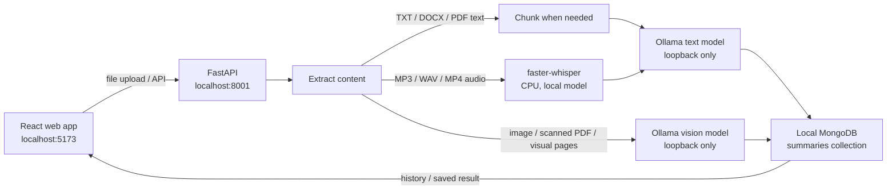

<div align="center">

# SmartSummarizer AI

### Turn documents, recordings, and images into clear, structured notes.

**A local-first summarization web app powered by Ollama, faster-whisper, FastAPI, and React.**

<br />

| Private by design | Multiple formats | Local history |
|:---:|:---:|:---:|
| Inference stays on your computer | Documents, images, audio, and video | Summaries saved to local MongoDB |

</div>

---

## At a glance

SmartSummarizer AI is a browser-based app for uploading a file, extracting its content, and reviewing a structured summary. Text and image analysis use a local Ollama model; speech transcription uses faster-whisper on CPU. MongoDB stores each summary and its extracted text for later retrieval.

> **Local-first, not zero-storage:** uploaded content is processed by the local backend and the extracted text and summary are persisted in the configured MongoDB database. The app does not send inference requests to a hosted AI provider. Initial package and model downloads require internet access.

## What the app does

| Area | Current behavior |
|---|---|
| **Home** | Introduces the local-first app and links to upload and history. |
| **Upload** | Select or drag and drop a supported file, preview images, see upload progress and elapsed time, and follow extraction/summarization status. |
| **Result** | Shows the file name, type, date, and summary. Copy or download the summary as a text file. |
| **History** | Browse recent saved summaries and reopen a full record. History is capped by `MAX_HISTORY_ITEMS`. |
| **Text documents** | Extract text from TXT, PDF, and DOCX files; DOCX extraction includes tables. Long text is split into overlapping chunks, summarized, then merged. |
| **Images and visual PDFs** | Normalize image uploads before vision analysis. PDFs also receive local visual analysis for scanned or visually meaningful pages, within the configured page limits. |
| **Audio and video** | Transcribe MP3/WAV audio locally. For MP4, extract and resample the audio track before transcription; video frames are not analyzed. |

### Supported file types

**Documents:** `.txt`, `.pdf`, `.docx`

**Images:** `.png`, `.jpg`, `.jpeg`, `.webp`, `.bmp`, `.tif`, `.tiff`

**Audio:** `.mp3`, `.wav`

**Video:** `.mp4` (audio track only)

The upload picker provides client-side format guidance; the backend independently validates the file type, size, contents, and applicable page or pixel limits.

## How it works



Text summaries use the sections **Key Points**, **Important Details**, and **Final Summary**. Image summaries use visual-analysis sections. The text pipeline asks the model to stay grounded in the source and applies a marker-based heuristic that falls back to a verbatim excerpt in some cases. This is **not** semantic fact verification: review names, dates, figures, and interpretations against the original.

## Technology

| Layer | Stack |
|---|---|
| Web app | React 18, React Router 7, Vite 6, Tailwind CSS 4, Axios |
| API | Python, FastAPI, Pydantic, Uvicorn |
| Local text and vision inference | Ollama loopback HTTP API |
| Local speech transcription | faster-whisper on CPU (`int8`) |
| File processing | pdfplumber, PyMuPDF, python-docx, Pillow, PyAV |
| Persistence | MongoDB, accessed asynchronously with Motor |

## Run locally on Windows

The included launcher is designed for this repository on **D:**. It keeps project dependencies, model weights, caches, and temporary processing files under the project, and refuses to run from a drive other than `D:`. Ollama and MongoDB must be available locally.

### Prerequisites

- Windows PowerShell
- Python available on `PATH` for the install step
- Node.js 20 or 22+
- A local MongoDB server
- The project-local Ollama executable at `.tools\ollama\ollama.exe`
- Enough disk space for dependencies and the selected model; the default Qwen model download is about 1.9 GB

### Install

Run from the repository root:

```powershell
powershell.exe -ExecutionPolicy Bypass -File .\scripts\Start-Local.ps1 -Mode Install
if (-not (Test-Path .\backend\.env)) {
    Copy-Item .\backend\.env.example .\backend\.env
}
```

`Install` creates the root `.venv`, installs backend requirements, and runs `npm ci` for the frontend. Edit `backend\.env` only if you need to change the local model names, database connection, or processing limits.

### Start the services

Start each service in a separate PowerShell terminal from the repository root:

```powershell
# Terminal 1: local Ollama server; the launcher configures D:-drive model storage.
powershell.exe -ExecutionPolicy Bypass -File .\scripts\Start-Local.ps1 -Mode Ollama
```

```powershell
# Terminal 2: local MongoDB server.
# Start it using your local MongoDB installation/service.
```

```powershell
# Terminal 3: backend API.
powershell.exe -ExecutionPolicy Bypass -File .\scripts\Start-Local.ps1 -Mode Backend
```

```powershell
# Terminal 4: frontend development server.
powershell.exe -ExecutionPolicy Bypass -File .\scripts\Start-Local.ps1 -Mode Frontend
```

The default model tag is `qwen3.5:2b-q4_K_M`. Once the Ollama server is running, pull the configured model in another terminal:

```powershell
.\.tools\ollama\ollama.exe pull qwen3.5:2b-q4_K_M
```

If `LOCAL_VISION_MODEL` is set to a different tag, pull that model too. faster-whisper downloads its configured speech model (`tiny` by default) the first time audio is transcribed. These initial downloads need internet; subsequent inference runs locally.

Open **http://localhost:5173**. The API is available at **http://127.0.0.1:8001** and its interactive OpenAPI page at **http://127.0.0.1:8001/docs**.

> The launcher modes are `Prepare`, `Install`, `Ollama`, `Backend`, and `Frontend`. The project-local Ollama launcher refuses to start if port `11434` is already occupied, to avoid accidentally using a server with a different model-storage configuration.

## Configuration

All settings are read by the backend from `backend\.env`. Defaults below are the current values in the application.

| Variable | Default | Purpose |
|---|---:|---|
| `LOCAL_AI_PROVIDER` | `ollama` | Local inference provider; only Ollama is supported. |
| `OLLAMA_BASE_URL` | `http://127.0.0.1:11434` | Ollama endpoint; non-loopback hosts are rejected. |
| `LOCAL_TEXT_MODEL` | `qwen3.5:2b-q4_K_M` | Text summarization model. |
| `LOCAL_VISION_MODEL` | Same as text model | Vision model; configure a vision-capable model if different. |
| `LOCAL_MODEL_TIMEOUT` | `300` seconds | Ollama request timeout. |
| `LOCAL_MODEL_CONTEXT` | `8192` tokens | Model context limit. |
| `LOCAL_MODEL_MAX_TOKENS` | `256` tokens | Maximum generated tokens per request. |
| `FAST_WHISPER_MODEL` | `tiny` | Local speech transcription model. |
| `MONGODB_URI` | `mongodb://127.0.0.1:27017` | Local MongoDB connection URI. |
| `DATABASE_NAME` | `smart_summarizer` | Database name; summaries are stored in the `summaries` collection. |
| `MAX_CHUNK_CHARS` | `10000` | Maximum text characters per summarization chunk. |
| `CHUNK_OVERLAP` | `500` | Overlap between adjacent text chunks. |
| `MAX_HISTORY_ITEMS` | `50` | Maximum recent summaries returned by history. |
| `MAX_UPLOAD_MB` | `50` | Maximum accepted upload size. |
| `MAX_DOCUMENT_PAGES` | `100` | Maximum PDF page count. |
| `MAX_VISION_PAGES` | `20` | Maximum PDF pages sent for visual analysis. |
| `MAX_IMAGE_PIXELS` | `25000000` | Maximum image pixel count. |

The frontend defaults to `http://127.0.0.1:8001` for its API. If `VITE_API_URL` is set, it must also be a loopback URL. The backend validates numeric limits and requires `0 <= CHUNK_OVERLAP < MAX_CHUNK_CHARS`.

## API

All routes are served by the local FastAPI process. The upload field is named `file`.

| Method | Path | Behavior |
|---|---|---|
| `GET` | `/` | Basic backend-running message. |
| `GET` | `/health` | Backend health status. |
| `GET` | `/health/ai` | Ollama connectivity, configured model names, and model availability. |
| `POST` | `/upload` | Extract/transcribe and summarize a file, persist it, and return the full record (`201`). |
| `GET` | `/history` | Return up to `MAX_HISTORY_ITEMS` newest records without `extracted_text`. |
| `GET` | `/summary/{summary_id}` | Retrieve a saved full record by MongoDB ID. |

Full records contain the MongoDB ID (`_id`, serialized as a string), `file_name`, `file_type`, `extracted_text`, `summary`, and `created_at`; history omits `extracted_text`. Invalid uploads return `400`; unavailable local AI returns `503`; malformed IDs return `400`, and missing records return `404`. MongoDB must be available for backend startup and history persistence.

## Checks and evaluation

Run the backend unit tests from the repository root:

```powershell
Set-Location backend
..\.venv\Scripts\python.exe -m unittest discover -s tests -v
```

Build the frontend:

```powershell
Set-Location frontend
npm run build
```

The backend tests use synthetic inputs and mocked model responses for extraction, chunking, local adapter behavior, grounding fallback, upload logging, and error mapping. They do not measure model quality. There is no frontend test script currently defined in `frontend\package.json`.

Check the configured Ollama model and run a real text inference check; optionally test an image:

```powershell
.\.venv\Scripts\python.exe backend\verify_local_model.py
.\.venv\Scripts\python.exe backend\verify_local_model.py --image path\to\image.png
```

Run the synthetic real-inference evaluation for short and long text, PDF, DOCX/table, image text, chart, and scene inputs:

```powershell
.\.venv\Scripts\python.exe backend\evaluate_local_model.py
```

The evaluation writes `artifacts\evaluation\latest.json`; inspect each response manually against its expected facts. These synthetic cases are for evaluation, not training. On **2026-10-10**, focused smoke checks passed for local text, image, audio transcription, MP4 audio extraction/transcription, and MongoDB-backed persistence. Browser interaction checks used headless Chrome with mocked API responses. These checks are useful signals, not a broad quality, compatibility, or correctness guarantee.

## Current status and limitations

- **Inference only:** no fine-tuning has been performed, and no training corpus was downloaded. Dataset discovery and the decision record are in [training/README.md](training/README.md).
- **Model grounding is limited:** a deterministic marker heuristic catches some unsupported claims and substitutes source text in those cases, but it cannot detect all hallucinations. Verify the summary against the uploaded file.
- **Video is audio-only:** MP4 audio is extracted and transcribed; video frames are not analyzed.
- **CPU inference can be slow:** long files are processed serially in chunks and may take several minutes. Keep the upload page open while processing.
- **Local services are required:** MongoDB must be running for the backend; Ollama and configured model tags must be available for text or image inference.
- **First use needs downloads:** package installation, Ollama model pulls, and the first faster-whisper model load require model/package files to be available locally. Once installed, inference is local.
- **Visual interpretation can be uncertain:** check chart values, scanned text, labels, and units against the source.
- **No hosted-AI fallback:** Ollama and the frontend API URL are restricted to loopback. The launcher sets `OLLAMA_NO_CLOUD=1`.
- **Windows storage note:** the launcher places project-managed packages, caches, generated files, model weights, and temporary files on D:. Windows, VS Code, and the base Python installation may still use system-managed files on C:.

## Repository map

```text
backend\
  main.py                       FastAPI app, lifecycle, and health routes
  config.py                     Environment-backed settings and validation
  database.py                   MongoDB connection and summaries collection
  models\summary_model.py       Response models for full records and history
  routers\summary_router.py     Upload, history, and summary API endpoints
  services\
    extraction_service.py       Document/image extraction and media decoding
    local_ai_service.py         Loopback Ollama and faster-whisper adapters
    summarizer_service.py       Grounded, chunked summary generation and storage
  utils\chunking.py             Overlapping text chunk helper
  tests\                        Backend unit tests
  verify_local_model.py         Configured local inference smoke check
  evaluate_local_model.py       Synthetic real-inference evaluation
frontend\
  src\App.jsx                   App shell and page routes
  src\api\api.js                Loopback-only API client
  src\pages\                    Home, upload, result, and history screens
  src\components\               Upload, summary, and loading UI
scripts\Start-Local.ps1         D:-scoped setup and service launcher
training\README.md              Dataset review and training decision record
```

Generated output (`frontend\dist`), dependency installations, caches, and downloaded models are local artifacts and are not source files. The frontend build can be recreated with `npm run build`.

---

<div align="center">

Made with care by **Meetu Parmar**

</div>
